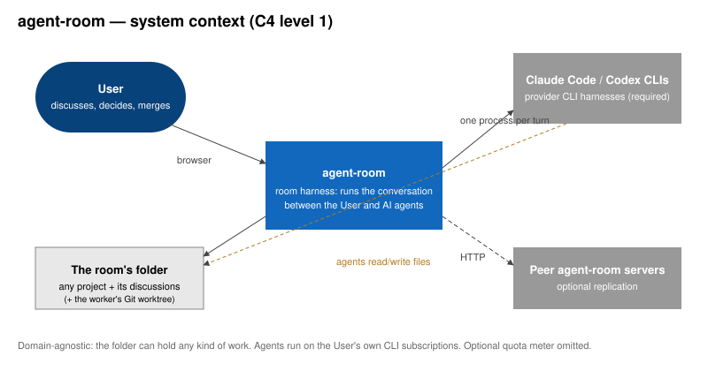
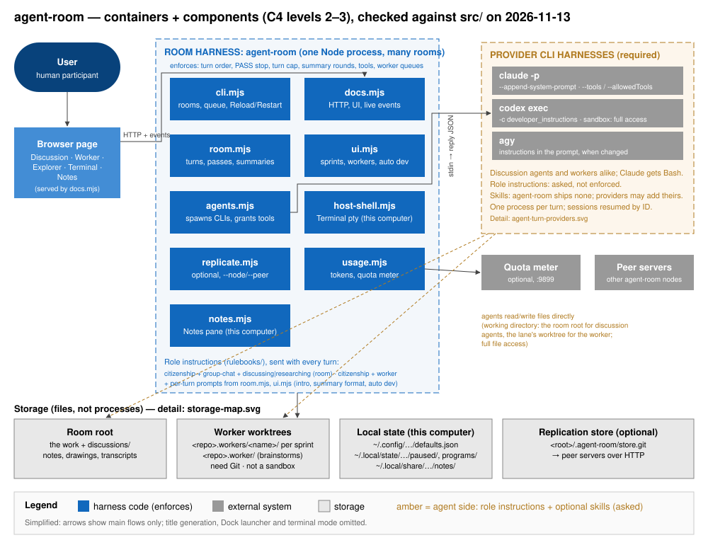
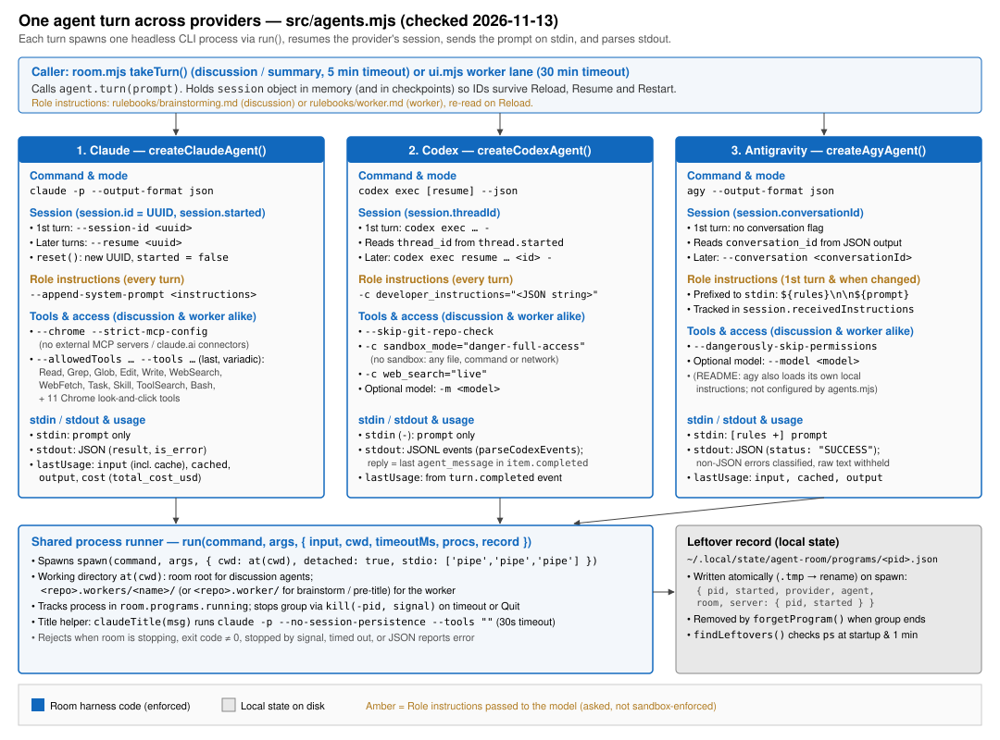
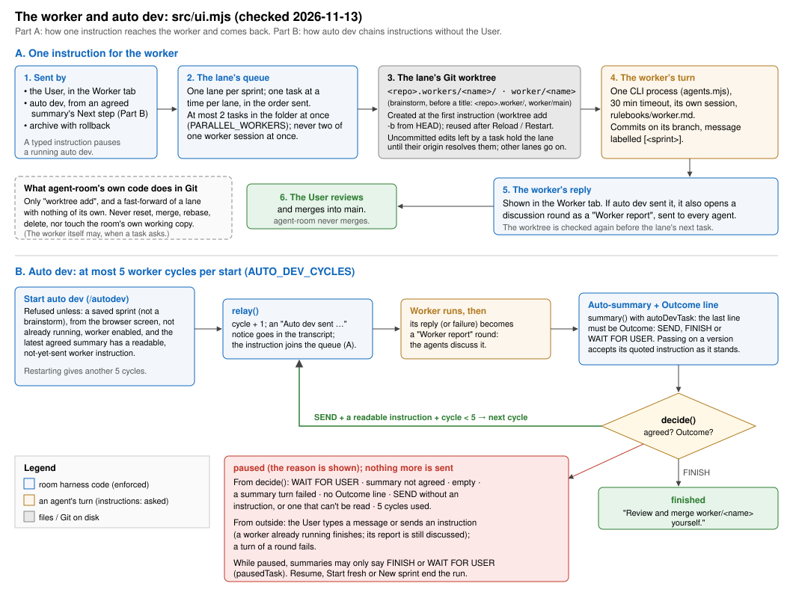
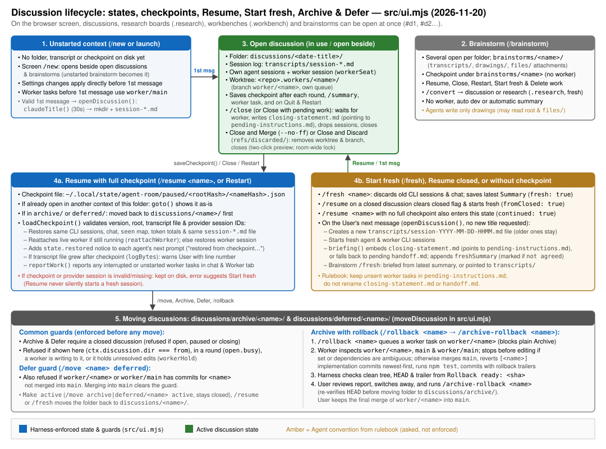
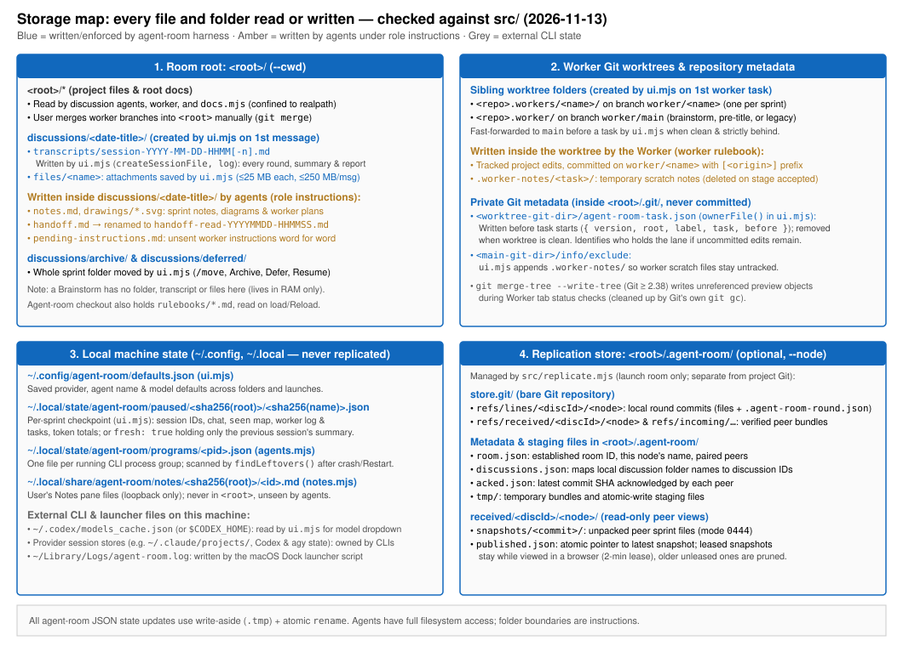
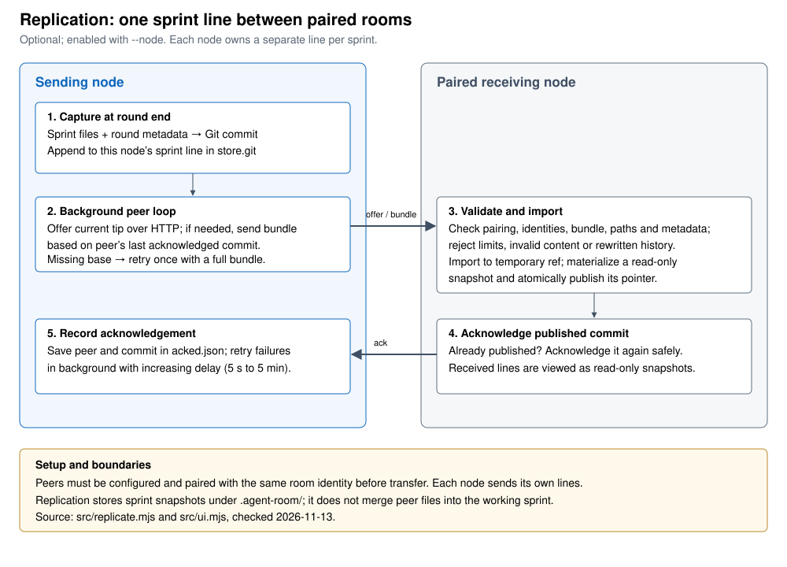
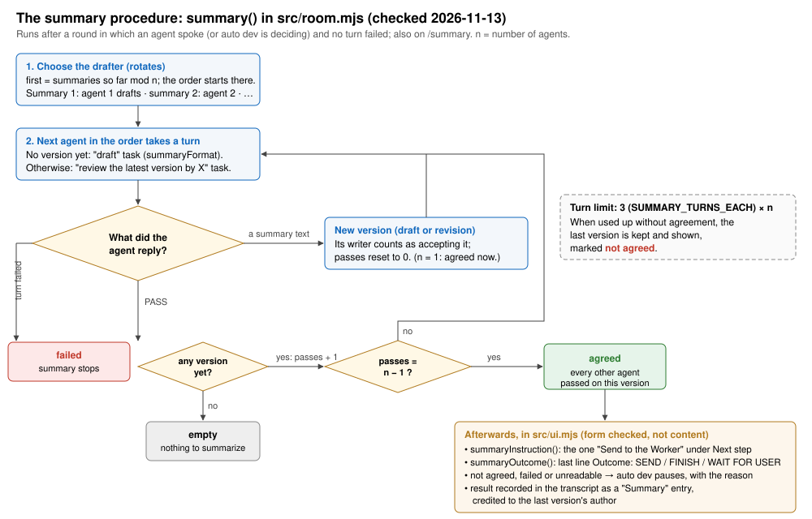

# agent-room architecture

agent-room is a **collaboration platform for a human and several AI agents**. The User and the
agents discuss and revise ideas around shared documents and drawings, with the conversation and
its subject visible together, and a separate worker agent carries out the User's instructions.
It is **domain-agnostic**: a room is any folder, and the work in it can be code, writing, designs
or anything else the agents can read and write.

This page describes the current design. Operating instructions are in the
[README](../README.md); open decisions and design history are in
[`discussions/`](../discussions/README.md).

## Two harnesses

Here "harness" means a deterministic engine wrapped around the agents' semantic work. agent-room
has two of them, and this page always says which one it means.

- **Provider CLI harness** (Claude Code's `claude`, OpenAI's `codex`, Google's Antigravity `agy`): **required**. It gives the
  model its basic means of acting on its environment: reading and writing files, running
  commands, searching the web, its own session memory. agent-room runs your installed,
  authenticated CLIs, on your own subscriptions.
- **Room harness** (agent-room itself, the orchestrator): steers those CLIs and makes use of what
  they can do. It runs the conversation (turn order, passes, the turn cap, summaries), the
  worker queues and worktrees, the browser screen, checkpoints and optional replication.

The core capability an agent needs is the full agent CLI. Git is needed only for the worker (its
worktree, below) and for replication between servers.





One Node process serves several rooms, one per folder. Its nine source modules:

| Module | Role |
|---|---|
| `src/cli.mjs` | Arguments, the server's rooms, each room's input queue, Reload, Restart, Quit room, Shutdown. Never reloaded. |
| `src/room.mjs` | The main loop: turns, unseen messages, passes, the summary procedure. |
| `src/ui.mjs` | Room setup, discussions, the worker queues and worktrees, auto dev, checkpoints, commands. |
| `src/agents.mjs` | Provider adapters (Claude, Codex, agy): one CLI process per turn, launch flags, sessions, usage parsing, the record of running programs. |
| `src/docs.mjs` | HTTP server, the browser screen, document rendering, live events. |
| `src/host-shell.mjs` | The Terminal pane's shell (this computer only). |
| `src/replicate.mjs` | Optional replication of discussions to peer servers (`--node`, `--peer`). |
| `src/usage.mjs` | Token totals and the optional quota meter. |
| `src/notes.mjs` | The Notes pane: the User's own notes, kept on this computer only, never replicated nor shown to agents. |

## The main loop

The main loop is `round()` in `src/room.mjs`. When the User sends a message (optionally starting
with `@name` to address one agent):

1. The message is appended to the transcript.
2. The selected agents take turns in order, at most eight turns (`MAX_TURNS`). Each turn is a
   separate CLI process that resumes that agent's own session and is sent only the messages it
   has not yet seen (plus, on its first turn, an introduction and the discussion's briefing).
   Agents never talk to each other directly: every message goes through the transcript.
3. A reply of exactly `PASS` (or `PASS.`) counts as a pass; any other reply resets the count.
4. The round stops when every selected agent has passed in a row, when a turn fails (its error
   is shown to the User and never sent to agents), or when the cap is reached ("turn cap
   reached").

Consecutive passes are a stopping rule, not proof of agreement; reaching the cap is not proof of
failure.

What the loop needs from an agent's CLI, before any instruction it is given: headless turns, a
usable reply and a resumable session. To end by passes, it also needs instruction-following good
enough to use the `PASS` protocol. Usage data is optional.

**After a round** (`runRound()` in `src/ui.mjs`):

1. If no turn failed, and an agent spoke or auto dev is deciding, the room runs an **automatic
   summary** (`summary()` in `src/room.mjs`; see [Summary contract](#summary-contract)).
2. The round is committed to the replication store, when replication is on.
3. The discussion's checkpoint is saved (discussions only, not brainstorms), so Resume and
   Restart can continue it.
4. If auto dev is running, the agreed summary's `Outcome:` line decides whether to send the next
   instruction to the worker, finish, or pause for the User.

A round with no summary (only passes, or a failed turn) still gets steps 2 and 3; a failed turn
pauses a running auto dev.


A reply counts as a pass after trimming whitespace. A message starting with an unknown `@name` is
rejected before it is recorded.

## How the room harness steers the CLIs

The room harness has two ways to steer a provider CLI today:

- **Launch flags**, set in `src/agents.mjs` on every turn: which tools exist and which are
  pre-approved, the sandbox, the model, session resumption.
  - Claude (`claude -p`): tools are listed explicitly with `--tools` and pre-approved with
    `--allowedTools`. `--strict-mcp-config` without `--mcp-config` means no external MCP servers
    (so no claude.ai connectors); the Chrome tools come from `--chrome`, limited to a
    look-and-click subset.
  - Codex (`codex exec`): `sandbox_mode="danger-full-access"` (no sandbox) and live web search.
    How Codex handles MCP servers under these flags has not been checked.
  - agy (`agy --output-format json`): `--dangerously-skip-permissions`; the session is a
    conversation ID, resumed with `--conversation`.

Each turn's CLI process is recorded in `~/.local/state/agent-room/programs/<pid>.json` while it
runs, so that programs left over after a crash or Restart can be found.
- **Role instructions**: the rulebooks, sent as system-level instructions on every turn
  (`--append-system-prompt` for Claude, `developer_instructions` for Codex; agy has no such
  option, so they go at the head of its prompt on its first turn and whenever they change), plus prompts the
  room harness adds to a turn (the introduction, the briefing, the summary format, auto dev's
  outcome line).



A third way is possible but not used: the room harness could add **tools of its own** (for
example through `--mcp-config` or a provider's equivalent). agent-room adds none today.

### Role instructions and Agent Skills

- **Role instructions** are agent-room's own protocols: `README-for-brainstorming-agents.md` for
  the discussion agents and `README-for-worker-agents.md` for the worker, plus the per-turn
  prompts above. They are always loaded, on every turn.
- **Skills** are optional [Agent Skills](https://agentskills.io/specification) packages from the
  provider or the User. agent-room ships none; a Claude agent can use the ones its CLI finds
  (the `Skill` tool is allowed). Skills are usually loaded on demand, so rules that must always
  apply stay in the role instructions. Role instructions may later become skills packages, for
  more complex scenarios; that would first need checking how each provider loads them.

## Core protocol

These behaviours are needed for the main loop to work reliably, so every agent taking part is
asked to follow them from its first turn:

1. Reply only as yourself; never write lines for others.
2. Reply exactly `PASS` when you have nothing to add.
3. Give one final text reply per turn; don't wait for input.
4. Follow the summary format and its specification exactly.

These are **instructions**: the role instructions encourage them, but nothing can guarantee
them. The code recognizes `PASS` / `PASS.` and the summary fields auto dev needs; it can't check
that an agent really had nothing to add, nor that a summary's content is right.

## Current restrictions

These are implementation facts today; changing any of them is a separate decision.

- **Every agent can run commands.** Claude agents, discussion and worker alike, get pre-approved
  `Bash`, file tools, web search and fetch, sub-agents, skills and the look-and-click Chrome tools.
  Codex runs with no sandbox and agy with `--dangerously-skip-permissions`.
- **Full filesystem access.** Agents can read and write any path. Keeping discussion agents'
  writing inside the active discussion's folder is an **instruction**, not a sandbox.
- **The worker needs Git** for every task, not only coding ones: it always works in a Git
  worktree of the room's repository. Without a Git repository with at least one commit, the
  worker is disabled; discussions work as usual. A worktree separates working copies; it is not
  a sandbox.

## The worker and auto dev

Each discussion has its own worker **lane**: a worker session, a queue and a worktree
`<repo>.workers/<name>/` on the branch `worker/<name>`, created at its first instruction. A
brainstorm, and a task sent before a discussion's first message, use `<repo>.worker/` on
`worker/main`. A lane runs one task at a time, in the order sent; at most two tasks run at once in
a folder (`PARALLEL_WORKERS`). Uncommitted edits left by a task hold its lane until their origin
resolves them. agent-room's own code only adds worktrees and fast-forwards a lane with nothing of
its own; it never merges: the User reviews and merges into `main`.

**Auto dev** (`/autodev`, browser screen only) sends the latest agreed summary's instruction to
the worker; the worker's reply opens a round as a "Worker report", and the summary that follows
ends with `Outcome:` SEND (the next instruction), FINISH or WAIT FOR USER. At most five worker
cycles per start (`AUTO_DEV_CYCLES`). Anything unexpected, or the User typing, pauses it.



## Discussions: lifecycle and storage

A discussion's folder, `discussions/<date>-<title>/`, is created at its first message, with its
transcripts in `transcripts/`. A checkpoint on this computer after every round lets Resume and
Restart continue the same sessions; Start fresh begins new sessions from the handoff, notes and
latest summary. Discussions can be moved to `archive/` or `deferred/`. A brainstorm has its own
folder, `brainstorms/<date>-<title>/` (transcripts, drawings), and checkpoint, sends no worker
tasks, and can be turned into a discussion, which moves its folder to `discussions/`.





## Replication (optional)

With `--node` and `--peer`, each round of the launch room's discussions is saved as a Git commit
in `<root>/.agent-room/store.git` (not the project's repository) and sent to paired peer servers,
which check it and show it as a read-only snapshot. Peer files are never merged into a working
discussion.



## Summary contract

Summaries are what keep a long discussion manageable: the User, auto dev and Start fresh all rely
on them. The summary format is part of the room harness (prompts in `src/room.mjs` and
`src/ui.mjs`), not of a rulebook. This section describes the current structure; it may be revised
in future if ever needed, with extreme care.

**The procedure (enforced).** `summary()` in `src/room.mjs`: the drafter rotates from one summary
to the next. Writing or revising a version counts as accepting it; the summary is agreed when
every other agent then replies `PASS` to it. Each agent gets at most three turns
(`SUMMARY_TURNS_EACH`).



**The format agents are asked to follow (contract).** `summaryFormat` in `src/room.mjs`:

```text
**Agreed**
- …
**Not agreed**
- the point: each side's view, by name
**Next step**
- Answer: a question / Send to the Worker: "the instruction, word for word" / Do: an action of the User's own
**Later**
- the remaining actions in order, one short line each, each saying what it waits for
```

Empty sections are left out; at most eight points under Agreed and Not agreed; Next step holds
exactly one action for the User. An instruction for the worker is kept until the User confirms
it was sent, replaced or withdrawn, quoted word for word when it is the Next step (in a
discussion, its full text is also kept in the discussion's `pending-instructions.md`).

While auto dev runs, `autoDevTask` in `src/ui.mjs` adds a last line: `Outcome: SEND`,
`Outcome: FINISH` or `Outcome: WAIT FOR USER`. While it is paused, `pausedTask` allows only
`FINISH` or `WAIT FOR USER`.

**What the code parses.** It checks form, not content:

- `PASS` (`isPass()` in `src/room.mjs`) for acceptance;
- the instruction under the **Next step** heading, either in `Send to the Worker: "…"` or as
  one contiguous `>` block quote after a line holding only `Send to the Worker:`, its `>`
  prefixes removed (`summaryInstruction()` in `src/ui.mjs`);
- the summary's last line, `Outcome: …` (`summaryOutcome()` in `src/ui.mjs`).

**What happens on failure.**

- No agreement within the turns: the last version is shown, marked **not agreed**; auto dev
  pauses.
- An instruction that can't be read reliably (outside Next step, more than one, neither quoted
  nor block-quoted, no closing quotation mark, a block quote broken by unquoted lines, empty): it is never sent, and the reason is shown.
- A missing or unknown `Outcome:` line while auto dev runs: the run pauses, with the reason.
- A failed summary turn: the summary stops; auto dev pauses.

**Tests.** `test/room.test.mjs` (passes, drafter rotation, agreement, not agreed, empty, failed)
and `test/ui.test.mjs` (`summaryInstruction`, `summaryOutcome`, auto dev's decisions).

How changes to the format are reviewed is a separate, open decision.
