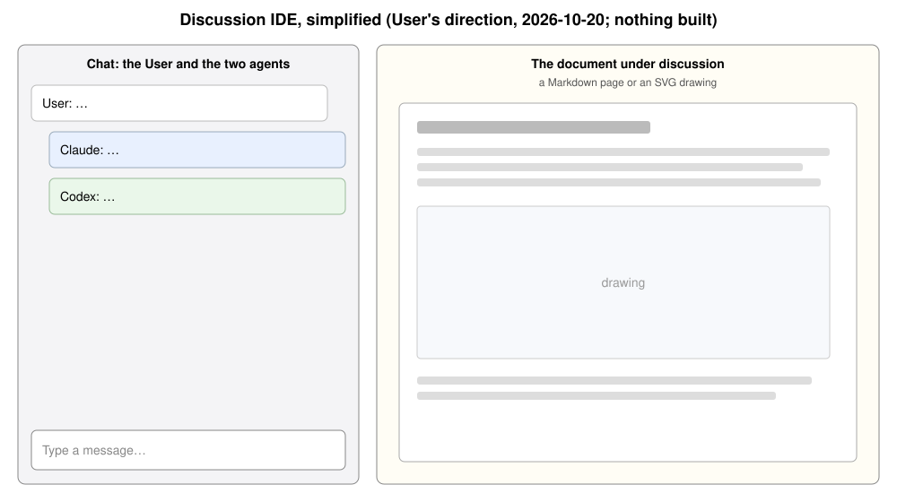

# Discussion IDE: chat on the left, a document on the right when you want one

> **Historical archive — 2026-11-02.** The basic interface is implemented. The README describes current behavior, including automatic summaries and discussion folders. Earlier status labels and next steps below describe the original discussion, not current work. See [the proposal index](../README.md).

Discussion of 2026-10-20 between the User, Claude and Codex. A first version is built (see
Built). Related: `../deferred/core-and-ui.md` (one codebase, future web UI).

(Checked rendered in Chrome on 2026-10-20, through agent-room's `/docs` viewer: both panes and
their labels display, nothing overlaps or is cut off.)

## What the User said (2026-10-20)
- "I cannot keep track of all the discussion and proposals… I need a visual representation
  and reason around it."
- Idea: turn agent-room into a discussion IDE. Left: the User's and agents' chat. Right: the
  document under discussion, revised together.

## Decided (by the User, 2026-10-20)
- **Keep it simple.** Left: the chat between the User and the two agents. Right: a Markdown
  document or SVG drawing from `proposal/`, when the User picks one. ("No controls" was replaced
  on 2026-10-20 by the decision below that the screen does everything the terminal does.)
- **A document is optional** (clarified by the User, 2026-10-20): at start-up nothing needs to be
  picked, and the agents are free to discuss. At any time the User can see the files in
  `proposal/` and pick one to watch live; when an agent changes that file, the User sees the
  change right away.
- Pointing agents at objects in an animation is **deferred** ("we can think about it later").
- DiagramTalk integration is **put aside** for now.
- **You choose the document** (answering open question 1): an agent editing another file
  doesn't replace it. (User, 2026-10-20; at first from the terminal's `/docs`, now from the screen.)
- ~~The screen sits beside the terminal, read-only~~ (User, 2026-10-20), **replaced the same day:**
- **In UI mode the screen is the whole interface** (User, 2026-10-20): `npm start` needs no
  terminal interaction; everything the terminal offers is on the screen (typing to the agents,
  an analog of `/docs`, `/usage`, `/reload`, `/quit`), input and output. The terminal it was
  started from only shows a log. `npm run terminal` keeps the terminal-only way.
- **A 2-second check for document changes is fine for now** (User, 2026-10-20).
- **Summary on request** (User, 2026-10-21): a summary command, not an automatic one. The agents
  have at most three turns each; if they don't all accept a version within that, the summary
  has failed and the last revision is shown as the result. Only the summary is shown (or that
  last version, if it failed); the full exchange is in the transcript. Built as `/summary` and a
  Summarize button, with the agents' suggestions: a revision counts as its author's acceptance,
  the drafter rotates, and versions use Agreed / Not agreed / Questions for the User.

## Built (first version, 2026-10-20)
- `npm start` opens the screen (`/__room` on agent-room's local viewer server), the room's input
  and output: a message box, Usage, Reload and Quit, and Documents (or `/docs`), which lists the
  files in `proposal/` at any time, even mid-round. The right pane stays empty until you pick
  one; then the page checks it every 2 seconds and reloads it when an agent changes it.
- `npm run terminal` keeps the room in the terminal; there `/docs` opens a file alone.
- Since then (2026-10-21): a draggable divider between chat and document; `/summary` (see
  Decided); and a macOS Dock launcher (`scripts/dock-launcher.applescript`, which runs
  `node src/cli.mjs --open`), so the screen can be started without a terminal. See the README.
- Checked live in Chrome with a real Claude turn (2026-10-20): a message typed on the screen
  reached Claude, Claude's edit to the watched file appeared on the right by itself, Usage and
  Quit worked, and the room's process exited. See the README for details.

## Proposed (by agents)
- **Agents edit one part of the document at a time**, not the whole file, so the User can
  keep their place while reading. (Codex, Claude)
- Evidence (Claude, read in `src/docs.mjs:62-68`, now lines 65-71; not run): today's `/docs` already shows a
  proposal file in the browser and reloads it when an agent changes it. That's most of the
  right pane already. But it reloads the **whole page**, which may move the User's reading
  position.
- The document follows the rulebook's habits: Decided kept apart from Proposed, each
  proposal attributed, open questions listed. Keep it short. (both)

## Open questions for the User
None left: both were answered on 2026-10-20 (see Decided). They were:
1. Who chooses which document is on the right: you, or the last one an agent edited?
2. Should this screen replace the terminal or sit beside it?

## Set aside by the simplification
Labelled parts and selection, change notes, "questions for you" count, Sketch/Preview/Proposal
tabs, alternative switch, live preview, DiagramTalk evaluation, Mermaid. Kept in this
conversation's transcript; not part of this proposal.

## Unresolved disagreements
- None.
