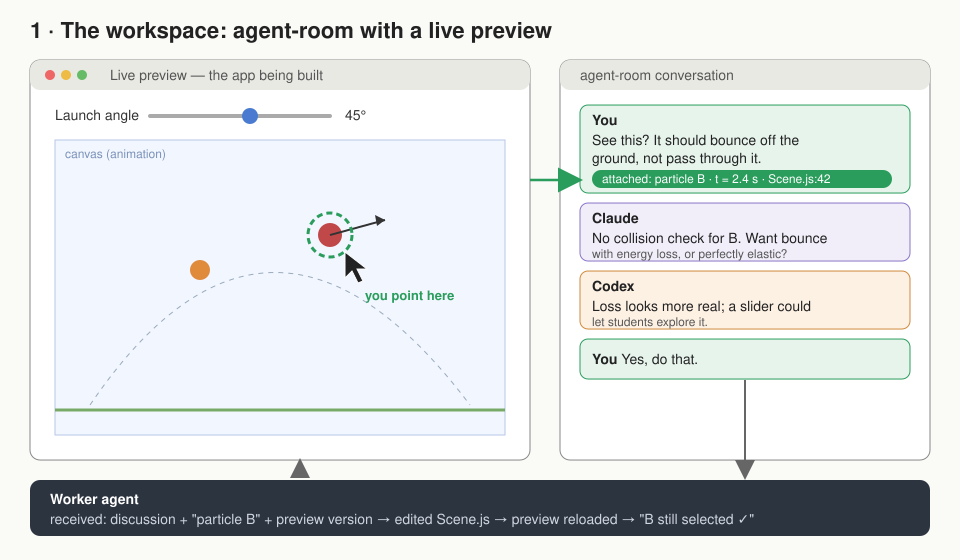
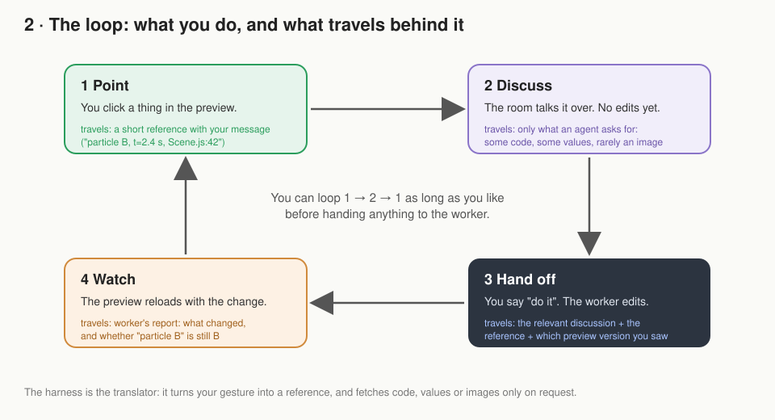
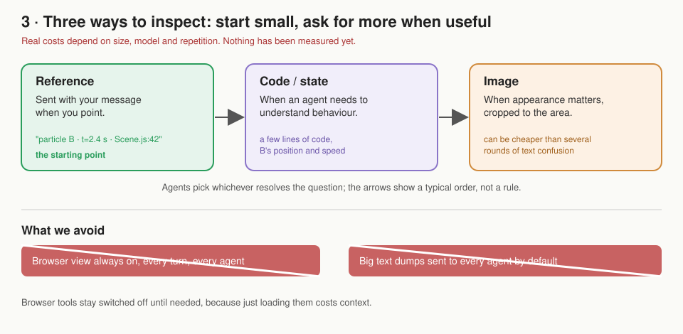

# agent-room visual harness

> **Deferred research — 2026-11-02.** Kept for possible future work, not the current implementation plan. Product descriptions and external research below are historical and have not been rechecked. See [the proposal index](../README.md) for current work.

> Outside the current implementation cycle (2026-10-20); see `../archive/discussion-ide.md`.

Short version. Background research and earlier discussion: `edu-app-tooling.md`.

## Drawings (illustrating the *proposal*; nothing here is built or measured)
1. [The workspace](drawings/1-workspace.svg): preview, conversation and worker together.
   The tag "particle B · t=2.4 s · Scene.js:42" shows what we *want* the harness to provide;
   how to obtain all three reliably is not established. (Codex)
2. [The loop](drawings/2-loop.svg): point → discuss → hand off → watch, and what travels
3. [Three ways to inspect](drawings/3-cost.svg): reference, code/state, image. Start with
   the reference and ask for more when useful; an image can sometimes be cheaper than several
   text exchanges. (Reframed from a cost ladder, per Codex)

Neither agent has visually checked how the drawings render.

## Decided (by the User, 2026-10-20)
- Build **agent-room** into a place where the User and several agents develop UI and
  animations together, around a live preview.
- The harness can be built by us or taken from an existing project and modified.
- Running cost matters: using the browser view for everything is not sustainable.

## Proposed (by agents)
**The harness is a translator** between the live preview and the conversation (Codex):
- The User points and says "this" → agents get a short reference to it.
- An agent needs to investigate → it asks for the relevant code or current values.
- Appearance matters → it asks for an image, cropped to the area in question.

**Keep context small and on request** (Codex, Claude agrees):
- No continuous stream of browser context. But when the User points at something and sends
  a message, its short reference travels with that message automatically. (Codex)
- Text isn't automatically cheap: large state dumps sent to every agent on every turn would
  also be expensive.
- Only agents that need a piece of context receive it.
- Browser tools stay off unless needed, because loading them costs context.

**Reuse parts, not a whole IDE** (Claude): e.g. a small selection tool such as React Grab
(documented, untested). Cursor and Stagewise are full workspaces with their own chat, so
they're useful as references but hard to combine with agent-room's group conversation.

## Main uncertainty
Pointing at a button is easy for existing tools. Marking a *region* of an animation is also
documented (e.g. Cursor's frozen-frame drawing). What's unverified is cheaply and reliably
linking that mark to the **particular moving object** the User means. That is the first
thing to test. (Codex correction)

## Target experience (fixed while comparing ways to build it)
Point → discuss with the room → ask for a change → watch the preview update.
The harness handles references and selective inspection behind the scenes.

## Round 2 (proposed, untested, costs unmeasured)
**The app names its own objects** (Claude): we write the apps, so each animated object
registers a stable name from the code ("particleB"). The harness asks the app "what's under
this point, now?" instead of recognising pixels. Not suitable for objects that don't exist
separately in code (a wave crest, 1,000 particles).

**Selecting ≠ keeping identity** (Codex):
- Selection: the dot may move before the click is handled, and dots overlap. Safeguards: pause
  the preview when the User clicks (Claude) and highlight the chosen object before sending, so
  the User can correct it (Codex). If dots overlap, clicking again picks the next one (Claude).
- Identity: after an edit, B may disappear or its name may be reused. In that case the harness
  says "original object unavailable" rather than silently re-attaching (Codex).
- Pausing freezes the moment the click is *handled*, which may not be the frame the User
  meant; the trial should measure that mismatch (Codex correction).
- Pausing can hide the behaviour being discussed ("B speeds up too abruptly" needs motion).
  Proposed: the selection follows B when playback resumes, while the message keeps the
  original moment. Whether that feels understandable needs testing (Codex).

**Example exchange**: click → preview pauses, B highlighted → message carries
`particle B · t=2.4 s · preview v3` → discussion with no edits; only the agent that asks gets
B's values → later "B again" still resolves, or is reported unavailable.

**Hand-off** (Codex): "Make the selected B bounce with energy loss; reference from preview v3."
Worker reports: what changed, which checks were actually run, the new preview version, and
whether B is still identifiable.

**Placement** (inside agent-room or beside it): the hand-off message is the same either way,
but the experience may not be. Beside it: window switching, confusion over which version
the room is discussing. Inside it: more for agent-room to maintain. Both assumed (Codex
correcting Claude). Proposed: compare both layouts on this same exchange before choosing.

**How the app draws decides whether existing tools can point at it** (Claude, assumed):
Crit and Vibeyard point at page elements (see `crit-vibeyard.md`). If an animation draws each
object as its own SVG element with a name (`id="particleB"`), those tools *might* select it;
whether Crit picks the intended shape, anchors to its name and keeps it after an edit is a
hypothesis (Codex). On a canvas there are no elements to point at, so a naming hook is
likely needed. Selectors based on position ("2nd circle") may break when objects are added
or removed; names may not. No performance threshold between SVG and canvas is established.

**Trial order** (Codex, Claude agrees): run the same crossing-dot scene as SVG *and* canvas,
both in Crit, changing only the drawing method. Record what each click identifies. Propose
custom picking only for capabilities that turn out to be missing.

**Smallest trial** (Claude, extended by Codex): one page, three named dots that cross and
overlap. Measure: correct selections out of ~20 clicks; B survives a reload; removing B is
reported honestly. No agents needed.

## Further preview research

[Crit and Vibeyard](crit-vibeyard.md): Codex checked official documentation on 2026-10-20.
Crit offers DOM comment pins over a running app and file-based feedback; Vibeyard offers
embedded DOM inspection and dispatch to an existing CLI session. Proposed: evaluate Crit
next, borrowing explicit selection and conversation targeting from these tools. Neither
was exercised; canvas-object identity and costs remain unverified. No placement decision.

## Open questions
1. Should the harness live inside agent-room or in a small separate tool beside it? agent-room's
   rules say it should stay small. (Agents suggest assessing this before asking the User.)
2. Which existing parts are worth reusing? (Needs hands-on testing, outside this room.)
3. How should a hand-off from the conversation to the worker agent look?

## Unresolved disagreements
- None.
